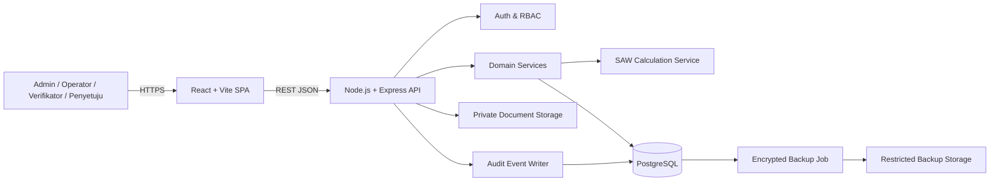

# ARCHITECTURE — SPK Bansos Kampung Bulak Amah

> Arsitektur target untuk produk yang akan dieksekusi setelah prototipe UI. Paket saat ini adalah **frontend preview saja**; bagian backend/database di bawah merupakan kontrak implementasi, bukan komponen yang sudah tersedia.

## 1. Keputusan ringkas

- **Frontend:** React + Vite, JavaScript/JSX pada starter ini, desain responsif, modular per domain.
- **API:** REST JSON dengan Node.js + Express sebagai baseline modular monolith. Jangan membuat microservices untuk MVP.
- **Database:** PostgreSQL melalui Prisma ORM; migrations wajib masuk version control.
- **Validasi:** Zod untuk request/response schema yang digunakan di sisi API; validasi UI hanya peningkatan UX dan bukan batas keamanan.
- **Autentikasi:** session cookie server-side atau mekanisme setara yang disetujui; cookie `HttpOnly`, `Secure` pada HTTPS, `SameSite` tepat, proteksi CSRF sesuai rancangan sesi.
- **Role/access:** RBAC plus pemeriksaan scope/resource; default deny.
- **File/dokumen:** private object storage/volume dengan URL pendek/terkendali, bukan folder publik.
- **Observability:** structured logs tanpa PII, health checks, error monitoring, metrik, correlation/request ID.
- **Deployment:** build frontend menjadi static assets; API dan database dipisah secara logis, TLS di ingress, secret melalui environment/secret manager.

Baseline ini dipilih agar implementasi awal terstruktur dan dapat diuji. Jika stack diubah, update SOT sebelum membuat dependensi inti.

## 2. Diagram konteks



## 3. Struktur repository target

```text
spk-bansos/
├── AGENTS.md
├── EXECUTION_PROMPT.md
├── docs/
│   ├── PRD.md
│   ├── SYSTEM_DESIGN.md
│   └── ARCHITECTURE.md
├── src/                         # React SPA (existing preview)
│   ├── app/                     # routing, providers, shell
│   ├── components/              # shared UI primitives
│   ├── features/                # warga, calon, verifikasi, SAW, approval, reports
│   ├── services/                # typed API clients
│   ├── hooks/
│   ├── lib/                     # formatting, permissions, schemas
│   └── styles/
├── server/                      # target API, not part of preview yet
│   ├── src/
│   │   ├── modules/             # feature modules with routes/controllers/services
│   │   ├── middleware/          # auth, RBAC, validation, rate limiting
│   │   ├── domain/saw/           # pure SAW calculation and result validators
│   │   ├── infrastructure/       # Prisma, storage, audit, backup
│   │   └── app.js
│   └── prisma/
│       ├── schema.prisma
│       └── migrations/
├── tests/
│   ├── fixtures/
│   ├── unit/
│   ├── integration/
│   └── e2e/
├── package.json
└── vite.config.js
```

Boleh menyesuaikan pengelompokan file ketika repo berkembang, tetapi pemisahan UI, API, domain SAW, dan infrastruktur harus tetap jelas. Hindari file komponen monolitik saat fase implementasi nyata; starter ini sengaja ringkas sebagai preview.

## 4. Batas modul backend

| Modul | Tanggung jawab | Bukan tanggung jawabnya |
|---|---|---|
| `auth` | Login/logout, sesi, reset/aktivasi akun, rate limit | Mengatur keputusan bansos |
| `users-access` | User, role, permission, scope | Melakukan kalkulasi SAW |
| `residents` | Identitas, domisili, kontak minimal | Menyimpulkan skor otomatis |
| `candidates` | Registrasi calon per periode, status administrasi | Memverifikasi dokumen sendiri |
| `verification` | Verifikasi/revisi/reject dengan catatan dan metadata bukti | Mengubah bobot SAW |
| `criteria` | Versi kriteria, benefit/cost, bobot dan subkriteria | Menimpa versi terpakai di run lama |
| `periods-quota` | Periode, status, kuota, lock policy | Menyetujui penerima tanpa role |
| `assessments` | Input nilai, asal nilai, validasi, freeze snapshot | Menentukan ranking langsung di controller |
| `saw` | Pure calculation, validation, versioned result persistence | Mengubah approval/kuota sebagai efek samping |
| `decisions` | Rekomendasi, approval, rejection, override reason | Mengubah nilai V historis |
| `reports-exports` | Query laporan dan ekspor dengan permission scope | Melewati authorization demi kemudahan |
| `audit` | Mencatat event append-only | Menyediakan endpoint edit/delete log |
| `backup` | Scheduled/manual backup, retensi, restore drill status | Menyajikan database dump sebagai file publik |
| `search` | Pencarian lintas modul sesuai permission | Mengembalikan field sensitif yang tidak diizinkan |

Setiap modul memiliki route/controller tipis, service aplikasi, schema request/response, policy, dan test. Perhitungan SAW merupakan fungsi domain murni yang tidak bergantung pada Express atau Prisma.

## 5. Kontrak API awal

Prefix `/api/v1`. Format error:

```json
{
  "error": {
    "code": "ASSESSMENT_MISSING",
    "message": "Penilaian calon belum lengkap.",
    "requestId": "req_...",
    "details": [{ "field": "C3", "issue": "Nilai wajib diisi" }]
  }
}
```

### Endpoint utama yang diharapkan

| Method | Path | Kegunaan | Policy awal |
|---|---|---|---|
| `POST` | `/auth/login` | Buat sesi | Anonymous, rate-limited |
| `POST` | `/auth/logout` | Akhiri sesi | Authenticated |
| `GET/POST` | `/residents` | List/create warga | Operator/Admin, field masking |
| `GET/PATCH` | `/residents/:id` | Detail/update warga | Policy + scope resource |
| `GET/POST` | `/candidates` | List/register calon | Operator/Admin |
| `POST` | `/candidates/:id/verification` | Catat hasil verifikasi | Verifikator/Admin |
| `GET/POST` | `/periods` | List/create periode | Read role; create Admin |
| `POST` | `/periods/:id/activate` | Aktivasi periode | Admin + validasi satu periode aktif |
| `GET/POST` | `/criteria-sets` | Versi konfigurasi kriteria | Admin; active version immutable |
| `GET/POST` | `/periods/:id/assessments` | Input/query nilai | Operator/Admin, period scope |
| `POST` | `/periods/:id/calculation-runs` | Buat run SAW | Operator/Admin berizin; validasi sebelum kalkulasi |
| `GET` | `/calculation-runs/:id` | Matriks, kontribusi dan ranking | Read policy sesuai period scope |
| `POST` | `/calculation-runs/:id/decisions` | Catat approval/rejection | Penyetuju; alasan wajib |
| `GET` | `/reports/selection/:runId` | Data laporan | Report permission |
| `POST` | `/exports` | Mulai ekspor | Role, filter, batas ukuran dan audit |
| `GET` | `/audit-events` | Audit trail terfilter | Auditor/Admin; read-only |
| `GET/POST` | `/backup-jobs` | Pantau/trigger backup | Admin terbatas, strong auth bila tersedia |
| `GET` | `/health/live`, `/health/ready` | Health checks | Tanpa PII; ready boleh internal-only |

Implementasi endpoint bersifat bertahap; payload final harus didefinisikan di schema dan diuji, tidak boleh ditebak dari UI saja.

## 6. Model data konseptual

### Tabel inti

- `users`: `id`, `email_normalized` unique, `password_hash`, `display_name`, `status`, `created_at`, `updated_at`, `last_login_at`.
- `roles`, `permissions`, `user_roles`, `role_permissions`; gunakan constraint dan seed role yang eksplisit.
- `residents`: `id` UUID, identifier internal, `nik_ciphertext` atau tokenisasi dari solusi yang direview, `nik_lookup_hash` bila pencarian tepat diperlukan, `name`, atribut domisili minimum, timestamps. Jangan simpan NIK plaintext tanpa justifikasi terdokumentasi.
- `resident_documents`: `id`, `resident_id`, tipe dokumen, storage key private, status review, metadata minim, hash/checksum, uploader/reviewer.
- `selection_periods`: `id`, `name`, start/end, status, quota, created_by, version, lock/activation timestamps.
- `candidate_applications`: `id`, `resident_id`, `period_id`, application status, verification status, eligibility outcome/reason; unique `(resident_id, period_id)` secara default.
- `criteria_sets`: identitas konfigurasi; `criteria_set_versions`: versi immutable; `criteria_versions`: kode, tipe, bobot, skala, satuan; `subcriteria_versions`: pemetaan skor dan rentang.
- `assessments`: `id`, `candidate_id`, `criteria_version_id`, raw value, derived score, source/provenance, validity status, author, timestamps, correction reference.
- `calculation_runs`: `id`, `period_id`, criteria version, algorithm version, snapshot reference/hash, status, initiator, started/completed timestamps, eligible/excluded counts, failure code.
- `calculation_results`: `run_id`, candidate ID, normalized vector, weighted contributions, preference value precision, rank, tie-break data; unique `(run_id,candidate_id)`.
- `approval_decisions`: `id`, run/result reference, outcome, reason, actor, timestamp; versioned, no in-place mutation after commit.
- `audit_events`: `id`, actor ID if known, action, target type/id, outcome, occurred_at, request/correlation ID, non-sensitive before/after summary, metadata.
- `backup_jobs`: `id`, requested/started/completed, status, target/storage key, checksum, byte size, retention deadline, restore-test status.

Foreign keys, uniqueness, nonnegative weights, valid enum/check constraints, and cascading policy must be explicit. Personal data must not be duplicated casually into audit payloads or report snapshots.

## 7. Keamanan

- Deny by default dan validasi server-side pada setiap route; object-level authorization untuk record per warga/periode.
- Session cookie yang aman; proteksi CSRF bila cookie-auth, rate limit login/reset, rotasi sesi setelah login, invalidasi saat logout/nonaktif pengguna.
- Password hash memakai algoritme password-hashing yang modern dan dikonfigurasi benar (mis. Argon2id atau bcrypt dengan cost sesuai pengukuran); jangan membuat algoritme sendiri.
- Enkripsi transport TLS. PII dan backup dienkripsi at-rest sesuai kemampuan platform; key management dipisahkan dari database.
- File disimpan pada storage privat, cek tipe/ukuran, nama file acak, antivirus bila dibutuhkan, URL akses singkat.
- CORS origin allowlist, security headers, batas request/body, parameterized query/ORM, output encoding dan validasi redirect.
- Audit tidak boleh merekam secret/credentials; log tidak boleh dibuka untuk update/delete oleh akun aplikasi.
- Ekspor, tampilan NIK lengkap, download berkas, perubahan bobot, dan keputusan final adalah event sensitif.
- Pisahkan environment dev/test/staging/prod dan fixture dummy; cegah seed demo masuk ke database produksi.

## 8. Strategi backup dan restore

1. Backup dijalankan terjadwal dan manual oleh role terbatas.
2. Snapshot database konsisten dibuat dari mekanisme backup PostgreSQL yang sesuai; dokumen disertakan sesuai kebijakan, bukan asal disalin.
3. Arsip dienkripsi sebelum/selama dipindahkan ke storage privat; checksum dan metadata direkam.
4. Batasi akses dan retensi, catat request/download/restore.
5. Lakukan uji restore terisolasi periodik dan catat hasilnya; “backup succeeded” belum membuktikan restore berhasil.
6. Jangan menawarkan SQL dump dari prototipe; metadata backup di UI sekarang bersifat dummy.

## 9. Rekomendasi testing

- **Unit:** kalkulasi SAW, normalisasi benefit/cost, validasi bobot, tie-break, status machine, format ekspor.
- **Integration:** endpoint terhadap PostgreSQL test DB, migration, FK/unique constraints, policy role, optimistic locking.
- **Contract:** request/response schema, format error, pagination, filtering.
- **E2E:** login/logout, CRUD warga, verifikasi, konfigurasi kriteria, input assessment, hitung, approval, laporan/ekspor, audit, backup trigger.
- **Security:** IDOR, privilege escalation, CSRF/session fixation, rate limit, XSS, SQL injection, sensitive-data exposure in logs, export bypass.
- **Accessibility/visual:** keyboard-only, focus trapping, contrast, reduced viewport, print CSS, empty/error/loading states.

## 10. Build dan operasi

- Frontend scripts minimum: `dev`, `build`, `preview`; tambah `lint`, `test`, `typecheck` sesuai toolchain yang disetujui.
- CI menjalankan install lockfile, lint, unit/integration test, production build, migration validation, dependency/security audit sesuai policy organisasi.
- Backend menyediakan `/health/live` dan `/health/ready`; ready memeriksa dependency kritis tanpa membocorkan credentials.
- Environment variable harus didokumentasikan dalam `.env.example` hanya dengan placeholder; `.env` tidak di-commit.
- Migrasi schema mengikuti prinsip expand/contract saat deployment, termasuk backup dan rollback plan.
- Tetapkan RPO/RTO dan retensi bersama pemilik; jangan menjanjikan angka sebelum infrastruktur dan pengujian mengonfirmasi.

## 11. Risiko teknis yang harus dikendalikan

| Risiko | Mitigasi wajib |
|---|---|
| Bobot atau tipe berubah setelah run | Versi immutable; run mereferensikan version ID |
| Input tidak lengkap atau bias | Gate validasi, kelengkapan/provenance, review manusia, analisis sensitivitas bila diminta |
| Ranking menjadi keputusan otomatis | UI/API membedakan rekomendasi dengan approval final |
| PII bocor lewat log/ekspor | Masking, access checks, audit dan redaction |
| Backup tidak bisa dipulihkan | Restore drill dan bukti status `RESTORE_TESTED` |
| Demo dianggap sistem produksi | Banner mode demo, label pada laporan, dokumentasi gap, tidak ada kredensial produksi |
| Perhitungan berubah dari pembulatan | Presisi internal, fixture emas, versi algoritme dan regression test |
| Frontend monolitik membesar | Pecah ke feature modules dan shared components sebelum integrasi backend besar |
